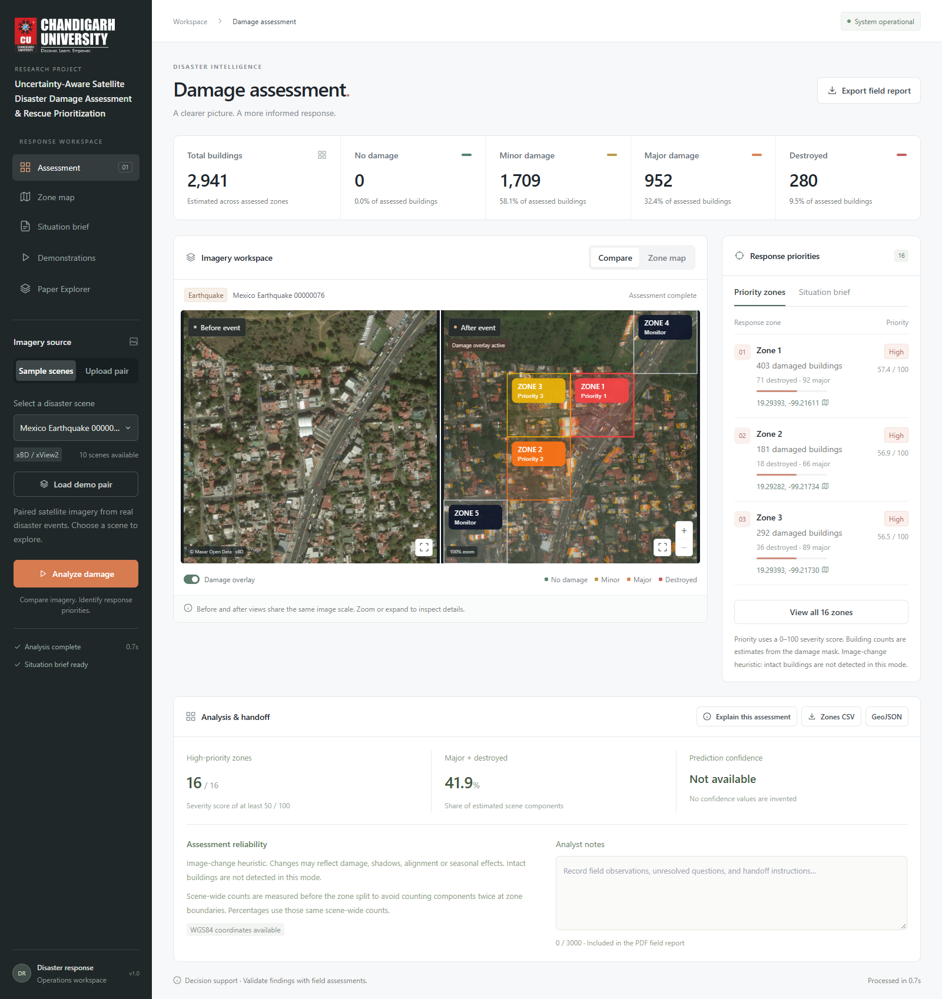
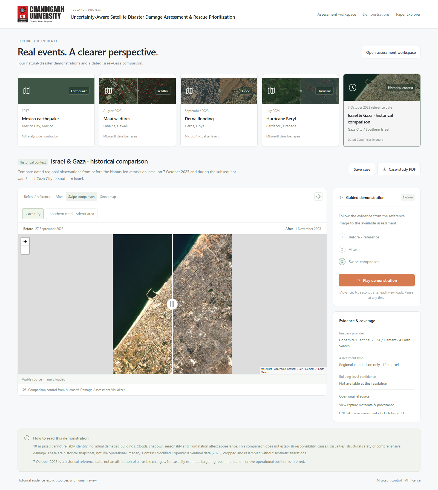
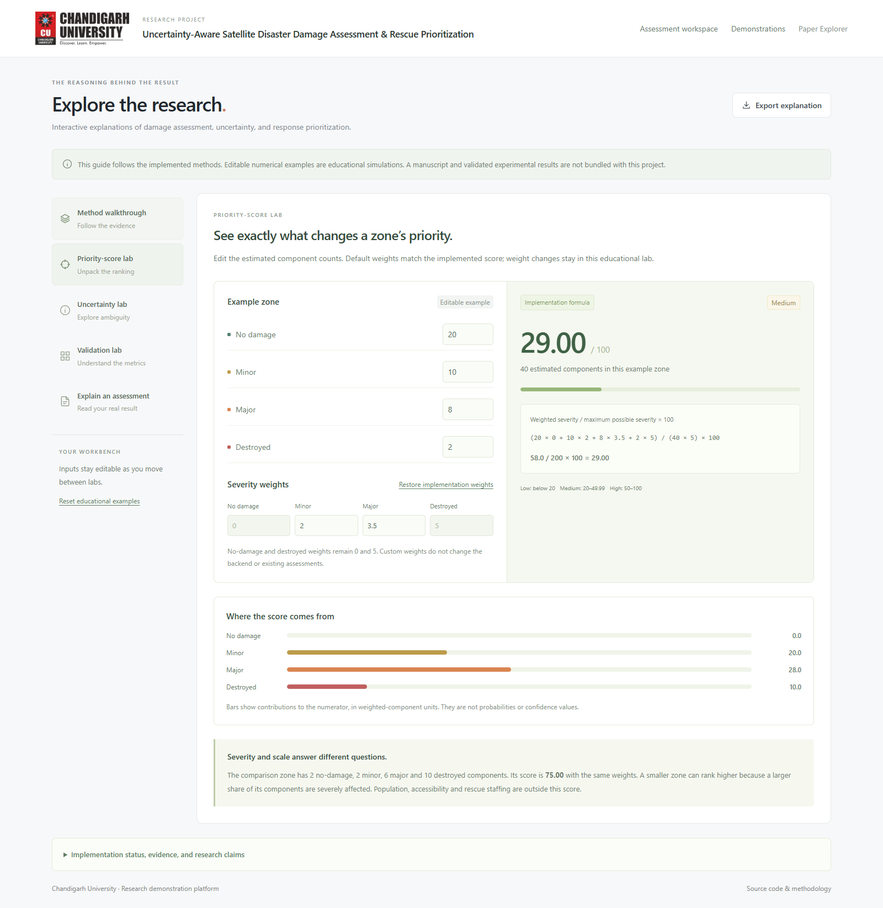
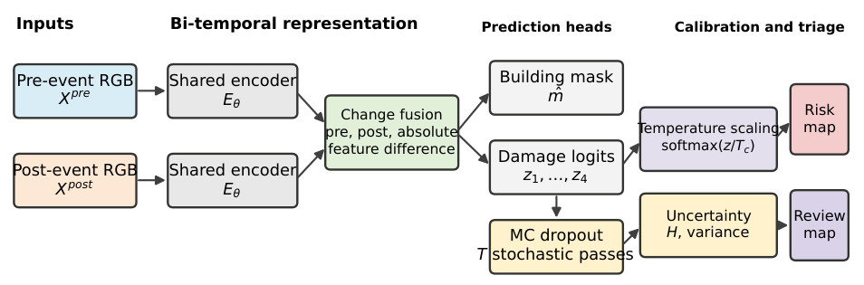
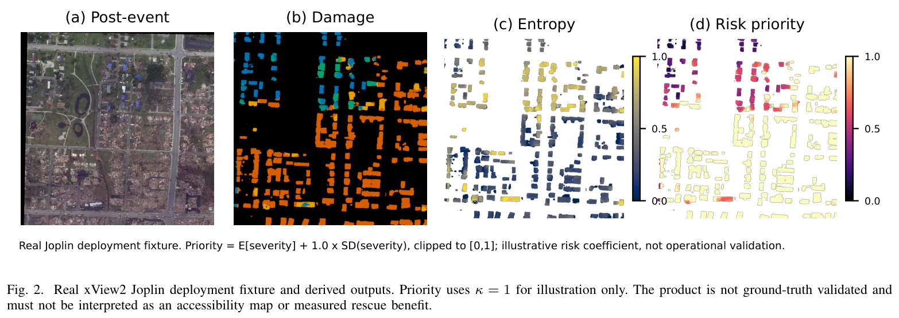

<p align="center">
  
</p>

# Uncertainty-Aware Satellite Imaging for Disaster Damage Assessment and Rescue Prioritization

**DisasterIQ · Research demonstration software · Chandigarh University**

**Research authors:** Prabhmannat Singh, Atharva Pratap Singh Chundawat, Srijan Sachdeva and Yogiraj Bhale.

This project explores how paired satellite images, damage estimates and explicit uncertainty can support disaster assessment. Its central research question is practical: **which areas appear severely affected, and which predictions need an analyst's attention?** The paper proposes separate outputs for these two decisions. The software provides an inspectable assessment workspace, real-event demonstrations, report exports and interactive explanations of the underlying concepts.

[Software features](#what-the-software-does) · [Paper diagrams](#diagrams-from-the-research-paper) · [Research method](#how-the-research-works) · [Research documentation](researchwork/README.md) · [Run locally](#run-the-software-locally) · [License](#license-and-attribution)

## Current software



*Actual software screenshot: the Mexico earthquake demonstration, including the image-change overlay, 16 response zones, scene summary and analysis/handoff tools. Displayed counts estimate connected components, not verified individual buildings.*

## What the software does

| Feature | What you can do |
|---|---|
| Paired imagery | Choose among ten bundled xBD scenes or upload before/after images. |
| Evidence inspection | Toggle the damage overlay, zoom and inspect either image in fullscreen. |
| Damage summary | Inspect scene-wide component estimates for no damage, minor, major and destroyed classes. |
| Response zones | Review a 4 × 4 spatial grid, severity scores, the top six zones or the full ranked list. |
| Zone map | Inspect geographic coordinates where xBD metadata supports them; use image coordinates for ordinary uploads. |
| Situation brief | Read a source-labelled summary. The default is a deterministic template; Fireworks narration is optional. |
| Reports and handoff | Record analyst notes and export a PDF, a full-zone CSV and geographically valid GeoJSON. |
| Disaster demonstrations | Explore the Mexico earthquake, Maui wildfires, Derna flooding and Hurricane Beryl. |
| Historical comparison | Compare separate Gaza City and Southern Israel areas using dated 27 September / 1 November 2023 imagery. |
| Guided map views | Play or pause a case walkthrough, use before/after swipe, change published-overlay opacity, inspect street maps and save cases. |
| Paper Explorer | Follow the method; edit priority examples; explore uncertainty and validation metrics; explain a real assessment and export its numerical explanation. |

The Mexico case executes the local analysis. The Maui, Derna and Beryl maps display published Microsoft/Planet imagery and source-produced overlays through a Microsoft Visualizer comparison control; they are not new predictions by this app. Historical Sentinel-2 imagery has 10 m pixels and supports regional comparison rather than individual-building damage assessment. Acquisition dates, provider credits and case-specific limitations are shown in the interface.

<details>
<summary><strong>See the current demonstration gallery and Paper Explorer</strong></summary>



*Four natural-disaster cases and a separate historical comparison, with source information, map controls and case-study reports.*



*The priority-score lab explains the implemented component-based score. Educational edits do not change backend rankings. Probability and confusion-matrix examples are simulations, not measured accuracy results.*

</details>

## Research and implementation status

These three evidence sources answer different questions:

| Evidence | What it establishes | What it does not establish |
|---|---|---|
| **Proposed full study** | A Siamese architecture, uncertainty/calibration equations and an event-wise evaluation protocol. | The supplied manuscript states that the proposed full training, baselines, calibration experiments and ablations were not executed. |
| **Pilot reported in the paper** | Post-processing of four public xView2 deployment fixtures using stored predictor outputs. | It has no matched ground truth; its counts and entropy are descriptive diagnostics, not accuracy, calibrated confidence or rescue-outcome evidence. |
| **This software** | A working heuristic assessment, source-aware maps, educational labs, explainable scores and exports. | The default app does not execute the paper's complete Siamese + MC-dropout + temperature-scaling model or its two probabilistic priority queues. |

No trained checkpoint for the proposed study ships with this repository. Optional Docker/PyTorch adapters exist, but they are not evidence that the proposed experiment has been completed. See [results and limitations](researchwork/results-and-limitations.md) and the [software-to-paper mapping](researchwork/software-guide.md).

## Diagrams from the research paper

### Figure 1: proposed uncertainty-aware architecture



*Source: supplied manuscript, Figure 1, page 3; direct PDF-rendered diagram crop. The proposed pipeline separates damage-risk priority from analyst-review priority. Neither output represents road accessibility. This is a research architecture, not a screenshot of the default inference engine.*

### Figure 2: Joplin deployment-fixture pilot



*Source: supplied manuscript, Figure 2, page 4. The paper derives these outputs from stored public xView2 scores. The risk coefficient κ = 1 is illustrative; no ground-truth validation or measured rescue benefit is established. The original figure's interpretation note and caption are retained.*

Both images are rendered from the supplied paper rather than recreated. [Figure provenance](researchwork/figures/README.md) records source pages, crop coordinates and SHA-256 hashes; an [extraction script](researchwork/tools/extract_figures.py) reproduces them from the source PDF.

## How the research works

1. **Compare matched observations.** Use pre/post RGB images and building annotations; keep entire disaster events apart across training, validation and testing.
2. **Learn a shared representation.** The proposed ResNet-34 Siamese encoder processes both dates with shared weights. The decoder fuses pre-event features, post-event features and their absolute difference.
3. **Localize and classify.** Separate heads predict buildings and four damage classes. Building supervision helps distinguish damage from unrelated landscape change.
4. **Estimate uncertainty.** Repeated stochastic dropout passes produce an average class distribution, normalized predictive entropy and inter-pass dispersion. The registered protocol starts at 30 passes and checks convergence on validation data.
5. **Calibrate confidence.** After freezing model weights, fit a positive temperature on validation data. Assess calibration separately using ECE, NLL, Brier score and reliability diagrams.
6. **Produce two queues.** Use expected ordinal severity and its spread for conservative risk priority; use predictive entropy for analyst-review priority.
7. **Evaluate before operational use.** Compare held-out event performance, class-wise metrics, calibration, ablations and sensitivity. Road accessibility requires independently validated data.

For class severity values $s=(0,1/3,2/3,1)$ and mean class probabilities $\bar p_c$, the proposed priorities are:

$$
\mu_D=\sum_{c=1}^{4}s_c\bar p_c,\qquad
\sigma_D^2=\sum_{c=1}^{4}\bar p_c(s_c-\mu_D)^2
$$

$$
R_i(\kappa)=\min(1,\mu_{D,i}+\kappa\sigma_{D,i}),\qquad
Q_i=-\frac{\sum_{c=1}^{4}\bar p_{i,c}\log\bar p_{i,c}}{\log4}
$$

**Risk and uncertainty are different.** A confidently severe prediction can have high risk and low entropy. An ambiguous prediction can warrant analyst review even when its expected damage is lower. The parameter κ expresses risk tolerance and needs sensitivity analysis; it is not an empirically proven rescue policy.

The running heuristic uses a different, deterministic zone formula:

```text
priority = 100 × (2 × minor + 3.5 × major + 5 × destroyed)
                 / (5 × total estimated components)
```

This score measures relative severity; it does not include calibrated uncertainty, population, travel time, road passability or rescue staffing. The heuristic cannot identify intact buildings, so a zero no-damage count does not establish that every building is damaged.

## Pilot diagnostics reported in the paper

The manuscript reports the following across four 1024 × 1024 deployment fixtures. These values are transcribed from Section IV-B; they were **not newly reproduced from this repository** during documentation preparation.

| Diagnostic | Manuscript-reported value |
|---|---:|
| Total pixels | 4,194,304 |
| Pixels passing the building rule | 597,881 (14.25%) |
| No-damage class pixels | 45,691 |
| Minor class pixels | 13,863 |
| Major class pixels | 45,700 |
| Destroyed class pixels | 492,627 |
| Mean normalized entropy over building pixels | 0.354 |
| Range of tile-wise mean entropy | 0.207–0.485 |

These are **pixels, not building counts**. Entropy computed from normalized stored scores is not MC-dropout epistemic variance or proof of calibration. Published comparison numbers elsewhere in the paper belong to their cited studies and are not results achieved by this software.

## Research documentation

The [`researchwork`](researchwork/README.md) folder is the reading companion to the paper:

| File | Contents |
|---|---|
| [literature.md](researchwork/literature.md) | Related work, primary-source links and the research gap. |
| [methodology.md](researchwork/methodology.md) | Architecture, uncertainty, calibration and the two priority formulations. |
| [experiments.md](researchwork/experiments.md) | Registered dataset splits, evaluation metrics, baselines and ablations. |
| [results-and-limitations.md](researchwork/results-and-limitations.md) | Reported pilot diagnostics, evidence boundaries and unresolved validation. |
| [software-guide.md](researchwork/software-guide.md) | What every application area does and its relationship to the paper. |
| [reproducibility.md](researchwork/reproducibility.md) | Required artifacts, provenance, experiment checklist and manuscript clarifications. |
| [references.bib](researchwork/references.bib) | Selected research references and manuscript citation. |
| [figures/](researchwork/figures/README.md) | Original-paper figure crops and reproducible extraction metadata. |

## Run the software locally

Use Python 3.12 and Node.js 20 or newer. The default demonstration requires neither a GPU nor an API key.

```powershell
# Terminal 1, from the repository root
.\scripts\start-backend.ps1

# Terminal 2
cd frontend
npm ci
npm run dev
```

Open **http://127.0.0.1:3000**. The backend runs on port 8000. For the published standalone frontend, `NEXT_PUBLIC_API_URL` can identify the backend when a direct connection is needed; consult the deployment guide for the selected hosting arrangement.

1. Select a scene or upload both images.
2. Click **Analyze damage**.
3. Inspect the overlay, ranked zones, map and situation brief.
4. Add notes and export a PDF, CSV or valid geographic GeoJSON.
5. Choose **Explain this assessment** to inspect its numerical score in the Paper Explorer.

### Inference modes

| Inference mode | Requirements | Confidence output |
|---|---|---|
| `stub` (default) | CPU image-change heuristic; no checkpoint | Unavailable |
| `docker` | Separately built xView2 baseline image and Docker host | Unavailable in this adapter |
| `pytorch` | Separately supplied checkpoint and compatible model code | Mean predicted-class probability per zone; not automatically calibrated |

Ground-truth demo masks are used for demo ordering and offline evaluation, never copied out as predictions. The optional narrator summarizes results without re-ranking them. See [deployment](DEPLOY.md), [data preparation](docs/DATA.md), [AMD compute notes](docs/AMD_COMPUTE.md) and [training material](ml/README.md). The research status above takes precedence over older experimental notes.

## Verification and contributions

The repository includes backend tests, calculator tests, browser checks and GitHub Actions. Software checks establish behavior and numerical consistency; they do not establish scientific model accuracy.

```powershell
cd backend
.venv\Scripts\python.exe -m pytest tests/ -q

cd ..\frontend
npm run typecheck
npm run test:research
npm run lint
npm run build
```

When both servers are running, use `npm run test:e2e`, `npm run test:demos` and `npm run test:paper` from `frontend`. Set `CHROME_BIN` when Chrome is installed at a different path. Contributions should preserve source attribution, separate synthetic examples from observations, and include evidence for new model-performance claims.

## Authors and citation

**Prabhmannat Singh · Atharva Pratap Singh Chundawat · Srijan Sachdeva · Yogiraj Bhale**

AIT-CSE, Chandigarh University, Mohali, Punjab, India.

Repository maintained under [PRABHMANNAT](https://github.com/PRABHMANNAT), with existing Team DarkNem software attribution retained. The accompanying paper is identified as an unpublished manuscript in [references.bib](researchwork/references.bib); no journal acceptance, DOI or publication venue is asserted. [CITATION.cff](CITATION.cff) supplies software citation metadata.

## License and attribution

Original project source code is available under **[Apache License 2.0](LICENSE)**, with **Copyright 2026 Prabhmannat Singh (PRABHMANNAT)** and the existing Team DarkNem notice retained.

Third-party material has separate terms: the bundled xBD demonstration subset is CC BY-NC-SA 4.0; Microsoft comparison code is MIT; Planet/Esri imagery, Copernicus data, university trademarks and manuscript figures retain their respective rights and attribution. The source-code license does not override those terms. See [NOTICE](NOTICE) and [figure provenance](researchwork/figures/README.md).

This research software supports inspection and explanation. It does not determine structural safety, casualties, road accessibility, rescue staffing or verified field conditions.
