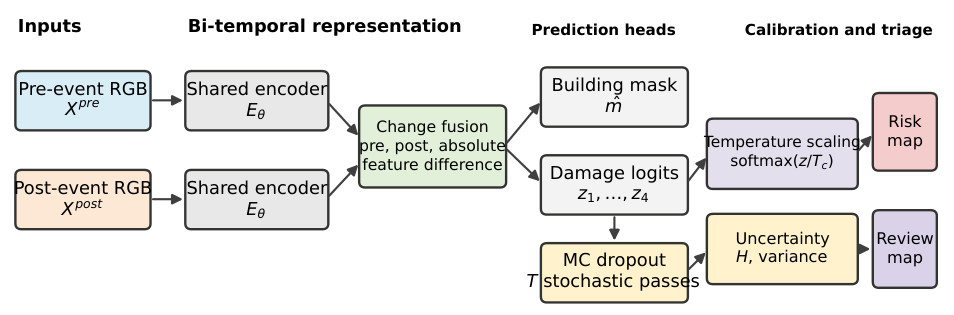

# Methodology

Source: supplied manuscript, Section III, pages 2–4. This document describes the **proposed research pipeline**. The [software guide](software-guide.md) separately identifies implemented behavior.

## Inputs, labels and leakage control

Each observation has matched RGB images before and after the event, a building mask, and damage labels on building pixels. The four damage classes are no damage, minor, major and destroyed. Unclassified polygons are excluded from damage evaluation.

The registered study groups train/validation/test splits by disaster event and prevents overlap among scenes and crop windows. It proposes 512 × 512 training crops from 1024 × 1024 imagery, with sliding-window inference and averaged overlapping predictions. Acquisition, alignment, clouds and radiometric differences require inspection; a visual difference alone is not damage.

## Shared-encoder bi-temporal model

The proposed ResNet-34 encoder shares weights between dates. At scale l, the decoder combines:

$$
[f_l^{pre},\ f_l^{post},\ |f_l^{post}-f_l^{pre}|]
$$

A localization head predicts buildings and a damage head predicts four damage logits. The manuscript combines Dice/BCE localization losses with a validation-selected weighted cross-entropy or ordinal loss for damage. It does not provide evidence that one unexecuted loss choice is optimal.

## Predictive uncertainty

Keep decoder dropout stochastic during T inference passes. For class c:

$$
\bar p_c(x)=\frac{1}{T}\sum_{t=1}^{T}p_{t,c}(x)
$$

Normalized predictive entropy measures ambiguity in the mean distribution:

$$
U_H(x)=-\frac{\sum_{c=1}^{4}\bar p_c(x)\log\bar p_c(x)}{\log4}
$$

It ranges from zero for a concentrated distribution to one for four equal probabilities. The registered inter-pass dispersion is:

$$
U_{epi}(x)=\frac14\sum_{c=1}^{4}\frac{1}{T-1}\sum_{t=1}^{T}(p_{t,c}(x)-\bar p_c(x))^2
$$

The protocol starts at T = 30 and checks validation-set convergence before increasing the pass count. The executed fixture pilot uses stored score maps; it does **not** produce this inter-pass MC variance.

## Calibration

After freezing weights, fit a positive temperature $T_c$ by minimizing validation negative log-likelihood:

$$
p_c=\operatorname{softmax}(z/T_c)_c
$$

The paper proposes 15-bin expected calibration error, NLL, multiclass Brier score and reliability diagrams. Positive scalar scaling preserves logit order, so unchanged argmax predictions do not improve classification F1 merely through calibration. The ordering of stochastic averaging and calibration must be logged explicitly in the final experiment; the manuscript's diagram and equations are not a complete implementation specification.

## Two priority outputs

For ordinal class values $s=(0,1/3,2/3,1)$:

$$
\mu_D=\sum_c s_c\bar p_c,\qquad
\sigma_D^2=\sum_c\bar p_c(s_c-\mu_D)^2
$$

The paper separates conservative damage-risk priority and analyst-review priority:

$$
R_i(\kappa)=\min(1,\mu_{D,i}+\kappa\sigma_{D,i}),\quad\kappa\ge0;
\qquad Q_i=U_{H,i}
$$

The severity variance is spread across ordinal class values, not automatically epistemic variance across stochastic passes. High risk can coexist with low entropy. Review priority routes ambiguous predictions for inspection. The pilot's κ = 1 illustrates arithmetic; it is not an operationally validated policy.

The manuscript allows building/cell aggregation but a reproducible implementation must specify its exact reduction and mask rules. Neither R nor Q models road access, casualties, staffing or travel time. The running application's component-weighted score uses a different formula, described in [software-guide.md](software-guide.md).
