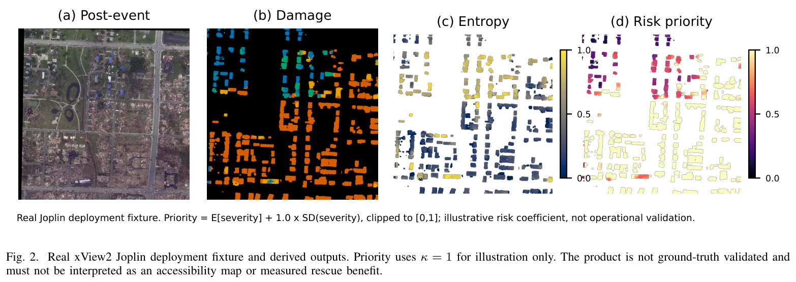

# Results and limitations

Source: supplied manuscript, Section IV-B, Table I and Figure 2. The diagnostics below are **reported by that manuscript**. Their original stored-score tensors and complete pilot analysis artifacts were not supplied with this repository, so this documentation update does not claim to reproduce them.

## What the paper reports

The executed pilot post-processes four public 1024 × 1024 xView2 deployment fixtures. It applies the published building-localization rule and conditionally normalizes four damage-score channels. It does not retrain the proposed network.

| Reported diagnostic | Value |
|---|---:|
| Total fixture pixels | 4,194,304 |
| Building-rule pixels | 597,881 |
| Building-rule share | 14.25% |
| No-damage class pixels | 45,691 |
| Minor class pixels | 13,863 |
| Major class pixels | 45,700 |
| Destroyed class pixels | 492,627 |
| Mean normalized entropy on building pixels | 0.354 |
| Tile-wise mean entropy range | 0.207–0.485 |

The four class counts sum to 597,881. They are predicted **pixels**, not numbers of buildings, casualties or verified damaged structures. A high share assigned to destroyed does not establish class accuracy without reference labels.

Figure 2 compares the Joplin post-event image, damage labels, entropy and illustrative risk priority with κ = 1. Its original caption warns against interpreting it as ground-truth validation, accessibility or measured rescue benefit.

## What remains unexecuted

- Training and held-out-event evaluation of the proposed full architecture.
- New baseline comparisons, ablations and statistical-significance tests.
- Validation-only temperature fitting and empirical calibration evaluation.
- Converged MC-dropout uncertainty experiments and comparison with ensembles.
- Field evaluation of road access, dispatch decisions, staffing, response time or lives saved.

Published xBD/BayeSiamMTL values reproduced in the manuscript's Table II are external context. They do not form a new directly comparable benchmark for this repository.

## What the application establishes

The running application exercises image ingestion, heuristic change analysis, deterministic component scoring, visual review, geographic exports where supported, reports and educational calculations. Its default method cannot detect intact buildings or estimate calibrated probabilities. Shadows, vegetation, seasonal changes and registration errors can resemble damage.

The software's component-weighted 0–100 zone score is distinct from the paper's probabilistic R and Q outputs. Microsoft published damage layers and the historical Sentinel-2 crops are separate evidence sources. They cannot validate the local heuristic or replace a held-out labeled assessment.

Software latency and passing tests describe implementation behavior. They do not demonstrate predictive accuracy, robustness, calibrated confidence or improved rescue outcomes.
